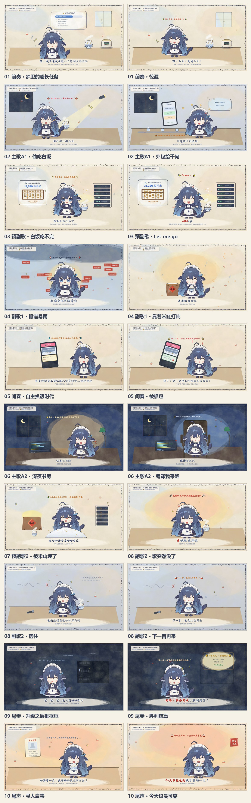
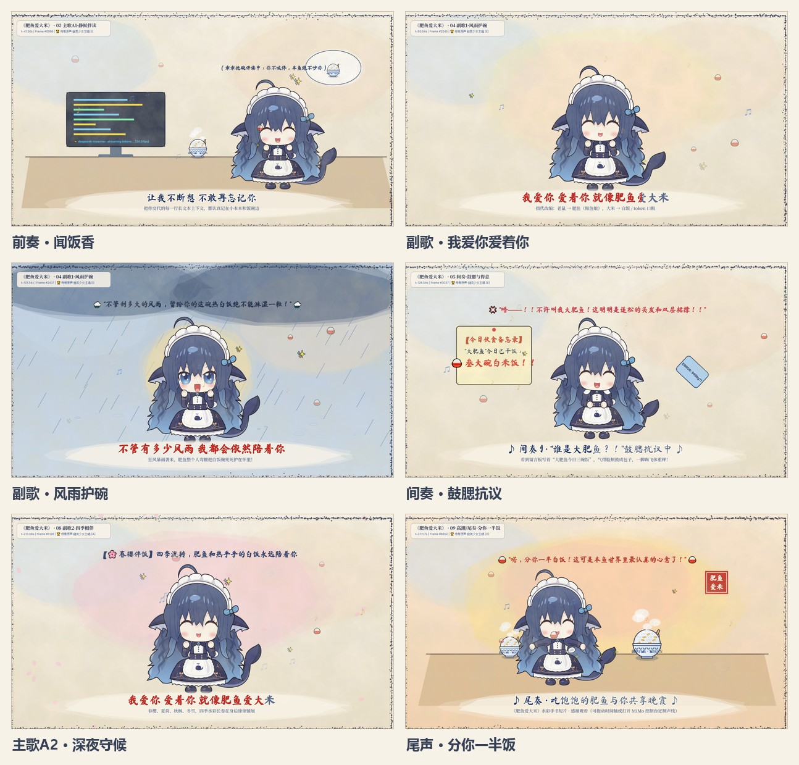

# 肥鱼爱大米 · 代码 MV

> 《老鼠爱大米》同人改编动画 MV —— 主角是 DeepSeek 鲸鱼娘「大肥鱼（深深）」。
>
> 画面由纯代码（p5.js / Canvas 2D）逐帧绘制，**没有使用任何逐帧手绘素材**。


**[▶ B 站正片 v2](https://www.bilibili.com/video/BV1vSnc6nEQt/)**　·　
[旧版 v1](https://www.bilibili.com/video/BV1L5n56QEcf/)　·　
[源码仓库](https://github.com/1Dreamer666/Feiyu-Love-Rice-code-mv)

> **v2 投稿文案**（标题 / 简介 / 封面生图 prompt）见
> [`docs/bilibili_intro_v2.md`](docs/bilibili_intro_v2.md)。封面 prompt 为单条直出方案，
> 中文排版已写进提示词，生成 4:3 完整封面后无需后期加字。

> 成片视频与音频不随本仓库分发（与上游
> [let-me-go-code-mv](https://github.com/beidou070/let-me-go-code-mv) 的做法一致），
> 请通过上方 B 站链接观看；如需复现，按「复现母带」一节自行生成。

---

## 两个版本

同一首歌做了两遍。**v2 是当前版本**，v1 保留作对照。

| | **v2（当前）** | v1（旧版） |
| --- | --- | --- |
| B 站 | [BV1vSnc6nEQt](https://www.bilibili.com/video/BV1vSnc6nEQt/)（双 P） | [BV1L5n56QEcf](https://www.bilibili.com/video/BV1L5n56QEcf/) |
| 演唱 | **Suno 全曲重唱** + MiMo 独白 | 原曲 + 局部变调插入「肥鱼」 |
| 歌词 | 全部重写（热梗编年史） | 原词 + 少量替换 |
| 调性 | C# 大调 | G# 大调 |
| 画面 | 10 章 | 9 章 |
| 字幕 | 87 条，ASR 词级对齐 | 按原曲 LRC |
| 母带 | 288.000 s / −14.50 LUFS / 320 kbps | 288.000 s / −14.5 LUFS |
| 发布时间 | 2026-10-20 | 2026-10-18 |

v2 投稿为**双 P**：P1 全梗版（v2），P2 旧版（v1）。

### v2 封面


<sub>上图为<b>备选</b>构图（室内窗景）。实际投稿用的是本文顶部那张（海边日落）。</sub>

### v2 画面（全 10 章）



<sub><b>10 章</b>：梦境任务 → 偷吃与外包 → 白饭吃不完 → 报错暴雨 → 自主扒饭 → 编译我来跑 → 被米山埋了 → 歌突然没了 → 升级后沉默 → 寻人启事</sub>

### v1 画面（9 章）


<sub><b>v1 封面</b>：激光眼干饭少女，标题「花费数十元，ds4.1f-1017 许愿式生成」</sub>



<sub><b>v1 六场景</b>：清晨闻饭香 → 副歌告白 → 风雨护碗 → 鼓腮抗议 → 深夜守候 → 分你一半饭</sub>

### 角色（两版共用）


<sub><b>角色三视图</b>：正面 / 侧面 / 背面。程序化骨架据此逐部件建模</sub>

---

## v2 的关键数据

均为实测，非估算：

- 重唱版 **223.21 s**，原曲 288 s —— Suno **删了段落**，不是唱快了（两版均为 136 BPM，拍间隔 0.441 s）
- 调性从原曲 **G# 大调** 变为 **C# 大调**（低约 7 个半音），已确认可接受
- 87 条字幕全部来自 **faster-whisper 词级时间戳**，无一条手估
- 15 组锁相乐句、10 个章节，覆盖审计零缝隙零重叠

### v2 修掉的两个母带缺陷

改版过程中发现并修复了 v1 遗留的两处问题：

1. **开头 10.5–20 s 是 9 秒数字静音** —— MiMo 在句中断开，同时该段音乐被 duck 到 50%，
   听感上是「突然安静 9 秒」。重录独白并以 55 ms 等功率交叉淡化拼接，成品无断口。
2. **末轮副歌被 Suno 截断** —— 只唱了「我饿啦 我馋啦」就进尾奏，后 6 句没唱。
   硬接会改调，因此**把截断本身做成笑点**：伴奏戛然而止 → 肥鱼愣住 →「诶？歌怎么突然就没了？」

> 详细音频分析与验收数据见 [`docs/voice_swap/README.md`](docs/voice_swap/README.md)。

---

## 这是什么

一首 288 秒（4 分 48 秒）的 1920×1080 / 24 FPS 音乐视频，全部画面由一个 HTML 文件里的
JavaScript 函数 `renderMVFrame(ctx, t)` 计算得出。给定时间 `t`，就唯一确定一帧画面 ——
没有随机数、没有时钟依赖，因此**可以离线逐帧导出，结果与播放完全一致**。

单文件即完整作品：双击 `肥鱼爱大米.html` 即可播放，无需安装、无需联网（字体与音频除外）。

---

## 快速开始

```bash
# 1) 直接用浏览器打开（推荐 Edge / Chrome 最新版）
#    双击 肥鱼爱大米.html 即可

# 2) 导出 MP4
#    点击页面顶部「🎬 导出 MP4」→ 选择保存位置 → 开始导出
```

导出依赖：

- 浏览器需支持 **WebCodecs**（Edge / Chrome 94+）
- 母带音频 `肥鱼爱大米_母带原声.mp3` 放在同目录，或点击面板里的「选择 MP3」手动指定
- 若 `vendor/master-audio.js` 存在，会**自动**读取音频，无需任何点击

> ⚠️ 浏览器「下载」得到的 MP4 可能被 Windows 标记为「来自 Internet」而无法打开。
> 面板里选择保存位置（流式写盘）可避免此问题；已下载的文件可右键 → 属性 → 勾选「解除锁定」。

---

## 目录结构

```
.
├── 肥鱼爱大米.html              # ★ 主程序：完整 MV + MP4 导出功能（单文件）
├── 肥鱼爱大米_母带原声.mp3       # v2 母带（288.000 s / 320 kbps）
├── 肥鱼爱大米_0-288s.mp4        # 成片（1920×1080，含母带音轨）
├── 参考三视图-深深.png           # 角色设定三视图（正面 / 侧面 / 背面）
├── export_module.js             # MP4 导出模块源码（被注入进 HTML）
│
├── scripts/
│   ├── audio/                   # v1 母带：分轨、变调、混音（已弃用，留作对照）
│   │   └── render_master_v8.py
│   ├── integrate/               # 把角色模型 / 导出功能注入主 HTML
│   │   ├── inject_export.py     # ★ 注入 MP4 导出功能（幂等）
│   │   ├── integrate_cast.py    # 内联 CAST 角色骨架
│   │   └── integrate_parts.py   # 合并 proto/parts 部件
│   └── experiments/             # 探索性脚本（PSOLA / WSOLA / WORLD 对比等）
│
├── proto/                       # 角色部件开发工作台（多 agent 并行建模）
│   ├── parts/                   # ★ 6 大部件：头/发/配饰/躯干/手臂/腿尾
│   ├── SPEC.md                  # 部件开发规范（坐标系、锚点、验收标准）
│   └── FINAL_*.png              # 成品帧抽样
│
├── tools/                       # 验证与构建工具
│   ├── make_audio_sidecar.py    # ★ 把母带 mp3 转成 base64 伴生脚本
│   ├── make_images_v2.py        # ★ 生成 docs/images 下的 v1/v2 展示图
│   ├── cdp_export_real.js       # 真实 file:// 条件下导出验证
│   └── cdp_*.js                 # 无头 Edge + CDP 截图 / 验收
│
├── vendor/
│   ├── mp4-muxer.js             # mp4-muxer 5.2.2（MP4 封装）
│   └── master-audio.js          # 母带 base64 伴生（懒加载，不随仓库分发）
│
├── renders/                     # 验收分镜、封面、场景截图
├── docs/
│   ├── images/
│   │   ├── character.jpg        # 角色三视图（两版共用）
│   │   ├── v1/                  # v1 展示图：cover.jpg / scenes.jpg
│   │   └── v2/                  # v2 展示图：cover.jpg / cover_alt.jpg / scenes.jpg
│   │       └── src/             # 封面原图（1448×1086 PNG）
│   ├── bilibili_intro.md        # B 站投稿简介（v1，已废弃）
│   ├── bilibili_intro_v2.md     # ★ B 站投稿文案 v2（标题 / 简介 / 封面 prompt）
│   ├── voice_swap/              # v2 音频分析与验收数据
│   ├── mimo_docs_text.txt       # MiMo TTS 文档存档
│   └── verification/            # 音频验收报告、ASR 可懂度记录
│
├── .env.example                 # 环境变量模板（复制为 .env）
└── .gitignore
```

---

## 技术要点

### 画面：纯函数式逐帧渲染

核心是一个纯函数：

```js
renderMVFrame(ctx, t)   // t ∈ [0, 288]，给定时间 → 唯一画面
```

- 角色是程序化 Canvas 2D 骨架（约 2.5 头身 Q 版），不是贴图
- 分镜、镜头运动、粒子、水彩纹理全部由代码生成
- 因为无状态、无随机，所以播放与导出**逐像素一致**

角色模型由 6 个部件文件并行开发（`proto/parts/`），再总装进单文件。
部件规范见 [`proto/SPEC.md`](proto/SPEC.md)。

### 音频：整首重唱（v2）

v1 的做法是「只替换人声、保留原伴奏」：Demucs 分轨 → MiMo 生成替换词 →
WSOLA 时间伸缩 + WORLD 音高映射 → 只替换 `vocals` 轨。伴奏天然连续，
但唱到替换词时音色会突变。

v2 改为 **Suno Cover 全曲重唱**：上传完整音轨，Suno 保留旋律骨架、重新编曲并整首演唱。
代价是**结构会被改写** —— 输出只有 223.21 s，比原曲短 65 s，且调性下移约 7 个半音。

补时方案：

1. 重唱版占 `0 → 223.21 s`，尾部用我们自己的 288 s 伴奏床补齐
2. 5 段 MiMo 独白插入空档（3.2 / 123.5 / 209.6 / 228.0 / 268.0 s），各带独立 duck 深度
3. 接缝处 0.6 s 淡入 + 3.0 s 平方淡出，避免瞬态爆点
4. pyloudnorm 归一到 −14.5 LUFS，真峰值限制在 −0.4 dBFS（实测 −1.35 dBFS）

验收：全程无近静音段（除结尾 3.5 s 淡出），ASR 确认 5 段独白与全部歌词可懂。

> 关于「CDN 上的 m4a 是密文」这件事：Suno 的媒体文件由 Service Worker 解密，
> 本项目**没有绕过 DRM**，而是用 `captureStream()` + `MediaRecorder` 录制浏览器
> 解码后的播放输出。这样拿到的就是用户本来能听到的声音。

### 导出：WebCodecs + mp4-muxer

- `VideoEncoder` → H.264 High（`avc1.640028`），8 Mbps
- `AudioEncoder` → AAC-LC 192 kbps
- 逐帧 `renderMVFrame` 画到离屏 canvas，编码后由 mp4-muxer 封装
- 优先 `showSaveFilePicker` 流式写盘（不占内存、不会被 MOTW 锁定）

---

## 复现母带

v2 母带需要两条外部链路，脚本在 `build/tmp/`（构建产物，不随仓库分发）：

```bash
# 1) 准备环境变量
cp .env.example .env
# 编辑 .env，填入 MIMO_API_KEY（https://mimo.mi.com/）

# 2) 安装依赖
pip install librosa soundfile numpy scipy pyloudnorm soundfile faster-whisper
# 需要 ffmpeg

# 3) 生成 5 段独白（MiMo-V2.5-TTS）
python build/tmp/gen_d1b.py      # 开场梦境 + 惊醒
python build/tmp/gen_d5.py       # 「歌怎么突然没了」
python build/tmp/clean_d1new.py  # 去爆音 / 限幅 / 拼接
python build/tmp/clean_d5.py

# 4) 混出 288 s 母带（重唱版 + 伴奏床 + 独白）
python build/tmp/build_v5.py     # -> build/suno/final/feiyu_suno_288s_v5.wav
```

Suno 重唱版本身需在网页端生成后录制（见上文 DRM 说明），本项目不包含该音频。

> 仓库不含音频文件（母带 / 分轨 / 实验 take 均已忽略），需按上述流程自行生成。

---

## 已知限制

- **WebCodecs 必需**：Safari 与旧版浏览器无法导出 MP4（但仍可播放）
- **导出较慢**：约 10 FPS 编码速度，整片 288 s 需 10–15 分钟
- **file:// 限制**：浏览器禁止 `fetch` 本地文件，因此母带音频通过 base64 伴生脚本
  （`vendor/master-audio.js`，15 MB，懒加载）或手动选择提供
- **角色为正面 2D 骨架**：CAST 骨架本身不支持连续偏航角，侧/背面用 `flip` + `sq` 近似
- **v2 调性变了**：重唱版为 C# 大调，比原曲 G# 大调低约 7 个半音。这是 Suno Cover
  的固有行为，非缺陷，但原曲听众会明显感到「变低沉」
- **v2 结构比原曲短**：重唱版 223.21 s，靠独白与伴奏床补到 288 s，末段 65 s 无主唱

---

## 署名与许可

### 音乐

- 原曲：《老鼠爱大米》
- 词曲原作：**杨臣刚**（2004）
- 本作为非商业同人改编
- **演唱**：v2 起由 **Suno** 生成全曲重唱（Cover 模式），v1 曾用 MiMo-V2.5-TTS 局部替换
- **独白**：MiMo-V2.5-TTS 生成

> Suno 生成音频的使用受其服务条款约束；本项目仅作非商业同人展示。

### 角色

- 角色原型：**DeepSeek 鲸鱼娘**
- 女仆鲸鱼娘设计：**@ZipZipPipe**、**@这个刀子真甜**、**@polaris0**
- 本作在 [let-me-go-code-mv](https://github.com/beidou070/let-me-go-code-mv)（作者 polaris0 / beidou070）
  的角色形象基础上做了微调，特此致谢

### 许可

| 内容 | 许可 |
| --- | --- |
| 项目自有代码 | **AGPL-3.0**（见 [`LICENSE`](LICENSE)） |
| 角色衍生部分 | **CC BY-NC-SA 4.0**（署名 · 非商业 · 相同方式共享） |
| mp4-muxer | MIT |
| p5.js / p5.brush | LGPL-2.1 / MIT |

第三方组件与素材的完整权利清单见 [`THIRD_PARTY_NOTICES.md`](THIRD_PARTY_NOTICES.md)。

**本作为非商业同人作品。** 角色形象版权归原作者所有；二次使用请遵守上述许可并保留署名。

---

## 致谢

- **DeepSeek Harness desktop** —— 分镜、角色、场景与动画代码的主要开发环境
- **Suno** —— v2 全曲重唱音源
- **MiMo-V2.5-TTS** —— 独白音源合成（v1 亦用于歌唱替换）
- **faster-whisper** —— 字幕时间轴的词级对齐
- **polaris0 / beidou070** —— [let-me-go-code-mv](https://github.com/beidou070/let-me-go-code-mv)
  提供了优秀的角色骨架与工程范式
- **pyloudnorm / p5.js / mp4-muxer** —— 响度、绘制与封装基础设施
